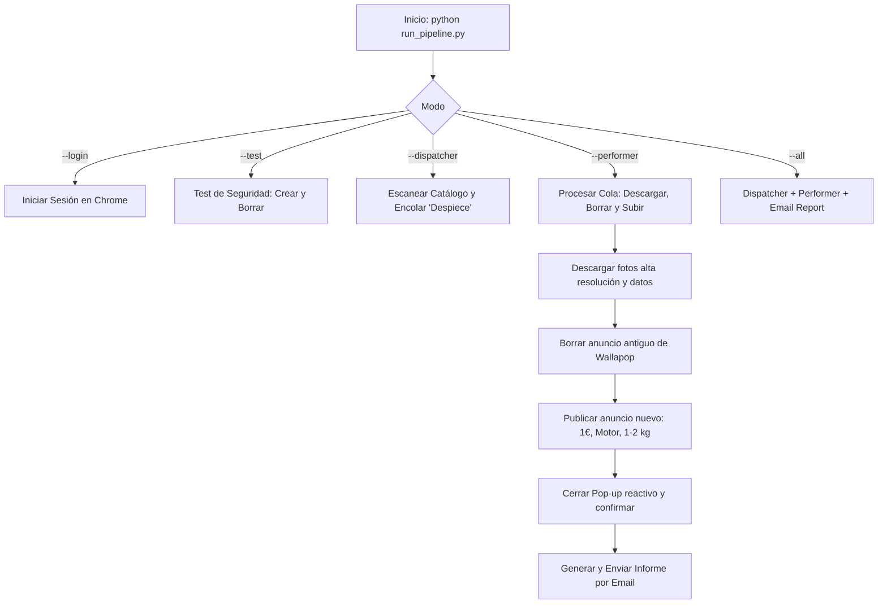

# GM_01: Automatización Wallapop - Republicador de Anuncios 'Despiece'

Sistema RPA desacoplado, transaccional y robusto (**Python + Playwright + SQLite + REFramework**) diseñado para gestionar y republicar anuncios de Wallapop de forma secuencial, segura y desatendida.

---

## 🎯 Objetivo del Sistema

El pipeline **GM_01** automatiza el ciclo de vida de los anuncios del usuario en Wallapop:



1. **Dispatcher (`local_dispatcher/`)**:
   - Abre Google Chrome con sesión persistente (`chrome_profile`).
   - Accede a tu catálogo de productos publicados (`https://es.wallapop.com/app/catalog/published`).
   - Verifica la sesión activa del usuario (con auto-espera interactiva si hiciera falta).
   - Escanea todos los artículos publicados con scroll infinito.
   - Filtra los que contienen la palabra clave configurada (**`Despiece`** por defecto).
   - Encola de forma atómica cada anuncio en la base de datos local SQLite (`local_queue.db`) con estado `New`.

2. **Performer (`local_performer/`)**:
   - Consume los ítems pendientes uno a uno bajo el estándar **REFramework** (procesamiento transaccional atómico).
   - Para cada anuncio:
     1. **Extracción**: Entra a la ficha del producto y extrae título, descripción y fotos en máxima resolución (usando metadatos `__NEXT_DATA__` y DOM de respaldo).
     2. **Descarga**: Almacena las fotos en la carpeta temporal local `temp_media/item_<id>/`.
     3. **Borrado Seguro**: Busca el producto original en el catálogo y lo elimina de Wallapop (confirmando motivo *"Ya no quiero venderlo"*). Si el borrado no se confirma, **se detiene inmediatamente** para evitar duplicados o inconsistencias.
     4. **Nueva Publicación**: Sube el producto con los parámetros exactos solicitados:
        - **¿Qué subirás?**: `Algo que ya no necesito`
        - **Información del producto / Resumen**: Título original
        - **Fotos**: Carga las imágenes descargadas
        - **Categoría y subcategorías**: `Motor y accesorios` -> `Recambios de motos y cuatriciclos` -> `Motor y piezas de motor`
        - **Título**: Limpia el campo (`Ctrl+A` + `Backspace`) y escribe el título
        - **Descripción**: Limpia el campo y escribe la descripción original
        - **Estado**: Selecciona `En buen estado`
        - **Precio**: Escribe `1€`
        - **Peso**: Selecciona `1 a 2 kg`
        - **Publicar**: Pulsa el botón de publicar
        - **Pop-up post-publicación**: Intercepta y cierra el diálogo modal al instante (neutralizándolo en el DOM si es necesario)
     5. Limpia la carpeta temporal local y marca la transacción como `Successful` (`SL-01`).

3. **Módulo de Reportes por Correo (`email_reporter.py`)**:
   - Al finalizar la ejecución, compila un informe completo en **HTML responsive** y texto plano.
   - Envía el informe por correo electrónico (SMTP/STARTTLS/SSL) con tarjetas de métricas, tiempos de ejecución y tabla detallada de cada anuncio procesado.

---

## 🏗️ Estructura del Repositorio

```text
GM_01/
├── browser_utils.py             # Gestión de Chrome persistente, anti-detección, sesión y cookies
├── email_reporter.py            # Generación de informes HTML y envío por correo SMTP
├── login_wallapop.py            # Asistente interactivo para inicio de sesión único
├── test_flow.py                 # Test de seguridad: sube anuncio de prueba y lo borra
├── local_queue.py               # Motor transaccional SQLite (New, InProgress, Successful, Business, System)
├── local_queue.db               # Base de datos SQLite transaccional
├── local_credentials.py         # Gestor seguro de credenciales de Windows
├── run_pipeline.py              # CLI unificado para control de todo el pipeline
├── requirements.txt             # Dependencias Python (playwright, pillow)
├── .gitignore                   # Exclusiones de perfiles, temporales y capturas
│
├── local_dispatcher/
│   ├── config.json              # Configuración del escáner (filtro 'Despiece', cola, etc.)
│   └── main.py                  # Lógica de extracción y encolado en catálogo
│
└── local_performer/
    ├── config.json              # Parámetros (precio 1€, peso 1-2kg, categorías, email, test)
    ├── exceptions.py            # BusinessException y SystemException
    ├── web_actions.py           # Core de automatización Playwright (selectores de alta calidad)
    └── main.py                  # Bucle transaccional REFramework y orquestación
```

---

## 💻 Puesta en Marcha en Otro Ordenador (100% Automática)

El proyecto cuenta con un sistema de **Auto-Bootstrap Inteligente**: no necesitas crear entornos virtuales a mano ni instalar paquetes manualmente.

### 1. ¿Qué archivos NO debes copiar / subir?
* **❌ `chrome_profile/`**: **NUNCA se debe copiar entre ordenadores.** Contiene cookies de sesión de Chrome, tokens y bases de datos locales vinculadas a la máquina original. Pesa cientos de megabytes y en otro equipo causaría errores. El perfil se creará limpio y automáticamente en el nuevo PC.
* **❌ `local_queue.db`**: **No hace falta copiarlo.** La base de datos SQLite se crea sola automáticamente en la primera ejecución.
* **❌ `venv/` o `.venv/`**: **No lo copies.** El script lo creará automáticamente con la versión de Python del nuevo equipo.
* **❌ `screenshots/` y `temp_media/`**: Archivos temporales de fotos y capturas.

> *(Todos estos archivos ya están excluidos en `.gitignore`).*

### 2. ¿Qué archivos SÍ debes pasar / subir al repo?
* Todo el código del proyecto (`run_pipeline.py`, `local_queue.py`, `browser_utils.py`, `email_reporter.py`, `login_wallapop.py`, `test_flow.py`, `requirements.txt`, y las carpetas `local_dispatcher/` y `local_performer/`).
* Las plantillas de credenciales: `.env.example` y `local_performer/.env.example`.
* Toda la documentación: `README.md` y `CLAUDE.md`.

---

### 3. Ejecución en el Nuevo Ordenador: Paso a Paso

#### Paso 1: Clonar el Repositorio y Configurar Credenciales
1. Clona o descarga el repositorio en el nuevo equipo.
2. Copia la plantilla de credenciales y crea tu archivo `.env`:
   ```powershell
   # En Windows PowerShell:
   Copy-Item local_performer\.env.example local_performer\.env
   ```
3. Abre `local_performer\.env` y pon tus credenciales de Gmail:
   ```env
   sender_email = "tu_correo@gmail.com"
   sender_password = "tu_contraseña_de_aplicacion"
   ```

#### Paso 2 (Solo la primera vez): Iniciar Sesión en Wallapop
```powershell
python run_pipeline.py --login
```
✨ **¿Qué ocurre automáticamente entre bastidores?**
1. Detecta que no hay entorno virtual: **crea la carpeta `venv/` de forma transparente**.
2. **Instala automáticamente** todas las dependencias (`requirements.txt`) y los binarios de Playwright (`chromium`).
3. Abre Google Chrome para que inicies sesión en Wallapop una sola vez.
4. Al detectar tu cuenta, guarda la sesión y se cierra solo: `¡SESIÓN GUARDADA CORRECTAMENTE!`.

#### Paso 2: Ejecución Normal y Automática
A partir de aquí, cada vez que quieras trabajar:
```powershell
python run_pipeline.py --all
```
* Ejecuta automáticamente el **Pre-flight Test** (crea anuncio de muestra y lo borra para verificar seguridad).
* Crea `local_queue.db` automáticamente si no existía.
* Escanea los anuncios con la palabra `Despiece` y los republica uno a uno.
* Al finalizar (o ante cualquier incidencia), te envía el informe por correo a tu Gmail.

---

## 🔍 Arquitectura y Calidad de los Selectores

Wallapop está desarrollada con componentes web modernos (**Stencil.js** y **Angular**), lo cual implica identificadores dinámicos y Shadow DOM. Todos los selectores de este proyecto han sido auditados y blindados con las siguientes reglas de calidad:

| Campo / Acción | Estrategia de Selección | Justificación Técnica |
| :--- | :--- | :--- |
| **Campos de Texto (Título, Precio, etc.)** | `div.inputWrapper:has(label:has-text('Nombre')) input:visible` y `page.get_by_label('Nombre')` | Wallapop genera atributos `id` y `name` con UUIDs aleatorios (ej. `3bd9d279-...`). Anclar el selector al contenedor padre con su etiqueta `<label>` garantiza detección infalible. |
| **Área de Texto (Descripción)** | `div.inputWrapper:has(label:has-text('Descripción')) textarea:visible` | Se localiza directamente el área de texto activa vinculada a la etiqueta, ignorando placeholders variables. |
| **Categorías y Subcategorías** | `*:has-text('{nombre}'):visible.last` | En la pantalla inicial ya existe un botón "Motor y accesorios" que queda oculto en el DOM. Usar `:visible` y `.last` garantiza pulsar la opción del menú recién abierto, nunca el elemento residual del paso 1. |
| **Botón 'Continuar'** | `button.walla-button__button--primary:visible, [data-testid='continue-button']:visible` con `force=True` | Evita bloqueos por oscilación de scroll en la barra de acción inferior adhesiva (*sticky*). Respaldo con `Enter` de teclado. |
| **Peso ('1 a 2 kg')** | `walla-radio:has-text('1 a 2'):visible, label:has-text('1 a 2 kg'):visible` con scroll previo | Los inputs radio nativos de Stencil tienen `opacity: 0`. Se apunta al componente contenedor o etiqueta con respaldo de eventos JavaScript. |
| **Botón 'Publicar'** | `walla-button:has-text('Publicar'):visible, button:has-text('Publicar'):visible` con scroll al final | Desplazamiento explícito a `document.body.scrollHeight` antes de pulsar, garantizando la visibilidad del botón en pantallas de cualquier resolución. |
| **Pop-up Post-Publicación** | `button.dialog__header__sideButton`, `button[aria-label='Close']` + Neutralizador DOM | Detección reactiva en < 300ms. Si el modal o su capa de fondo (`backdrop`) intenta bloquear la pantalla, se elimina directamente del árbol DOM (`m.remove()`), liberando el scroll inmediatamente. |
| **Borrado de Anuncio** | Tarjeta `:has-text(...)` -> Menú de 3 puntos -> Opción Eliminar -> Motivo -> Confirmar | Si el menú de 3 puntos en la tarjeta no respondiera, el bot entra a la URL del anuncio (`/item/...`) y pulsa eliminar desde la propia ficha del producto. |

---

## 🕹️ Guía de Comandos (CLI)

Todos los comandos se ejecutan desde la carpeta raíz mediante `run_pipeline.py`:

```powershell
# 1. Autenticación (solo la primera vez)
python run_pipeline.py --login

# 2. Pruebas de seguridad
python run_pipeline.py --test          # Test completo: sube anuncio de prueba y lo borra
python run_pipeline.py --test-delete   # Solo borra el anuncio de prueba si ya estaba subido

# 3. Ejecución paso a paso (supervisada)
python run_pipeline.py --dispatcher    # Paso A: Escanea y encola sin tocar nada
python run_pipeline.py --list          # Paso B: Revisa los anuncios detectados
python run_pipeline.py --performer     # Paso C: Procesa, borra originales y republica

# 4. Ejecución completa automática (con Pre-flight Test previo obligatorio)
python run_pipeline.py --all           # Lanza Pre-flight Test -> Dispatcher -> Performer
python run_pipeline.py --performer     # Lanza Pre-flight Test -> Performer

# (Opcional) Si se desea omitir la prueba previa obligatoria:
python run_pipeline.py --all --skip-test

# 5. Monitorización de la cola SQLite
python run_pipeline.py --status        # Resumen numérico por estados
python run_pipeline.py --clear         # Cancela los ítems pendientes (pasa a Abandoned)
```

---

## ⚙️ Configuración, Credenciales en `.env` y Envío de Informes

### Credenciales en `.env` (`local_performer/.env`)

Para mantener las contraseñas seguras y fuera de archivos JSON, las credenciales de correo se leen automáticamente del archivo `.env` ubicado en `local_performer/.env`:

```env
sender_email = "tu_correo@gmail.com"
sender_password = "xxxx xxxx xxxx xxxx"
```

> [!NOTE]
> El cargador de `.env` limpia comillas, comas accidentales y espacios en contraseñas de aplicación de Google, garantizando autenticación SMTP directa e instantánea.

### Configuración del Performer e Informe por Email (`local_performer/config.json`)

```json
{
  "queue_name": "GM01_WallapopQueue",
  "db_path": "../local_queue.db",
  "headless": false,
  "browser_type": "chromium",
  "timeout_ms": 30000,
  "slow_mo_ms": 150,
  "delay_between_items_ms": 2000,
  "profile_dir": "chrome_profile",
  "price": "1",
  "weight": "1 a 2 kg",
  "condition": "En buen estado",
  "upload_type": "Algo que ya no necesito",
  "category_path": [
    "Motor y accesorios",
    "Recambios de motos y cuatriciclos",
    "Motor y piezas de motor"
  ],
  "preflight_test": true,
  "stop_on_error": true,
  "test_ad": {
    "title": "Despiece Motor de Prueba Test GM_01",
    "description": "Anuncio de prueba automatizada para verificar el proceso de subida y posterior borrado. Por favor no comprar.",
    "sample_image_name": "test_sample_despiece.jpg"
  },
  "email_report": {
    "enabled": true,
    "recipient_email": "tu_correo_de_destino@gmail.com",
    "smtp_server": "smtp.gmail.com",
    "smtp_port": 587,
    "use_tls": true
  }
}
```

---

## 🛡️ Políticas de Seguridad y Tolerancia a Fallos

1. **Pre-flight Test Obligatorio**: Cada vez que se ejecuta el pipeline (`--all` o `--performer`), se ejecuta primero una prueba real completa de subida y borrado. Si la prueba falla, **la ejecución se detiene de inmediato** y se envía el informe con el error. Ningún anuncio real se modifica si la prueba no pasa al 100%.
2. **Fail-Fast (Parada Inmediata ante Error)**: Con `stop_on_error: true`, si surge cualquier error funcional o técnico durante el procesamiento de un anuncio real, la ejecución de la cola se interrumpe al instante para evitar publicar anuncios erróneos o duplicados, y se envía el informe de alerta con banner rojo al correo.
3. **Protección de Datos Originales**: Si el bot no puede descargar la totalidad de las fotos de un anuncio original, **se detiene de inmediato** y no borra el anuncio original para evitar cualquier pérdida de fotos o información.
4. **Prevención de Duplicados**: Si el borrado en Wallapop no se puede confirmar con éxito, el bot **aborta la transacción** y no publica el nuevo producto.
5. **Auditoría Visual**: En cualquier fallo técnico inesperado, el sistema toma una captura de pantalla completa y la guarda en `screenshots/error_item_<id>.png`.
6. **Ciclo de Reintentos**: Los fallos de red o tiempos de carga se reintentan hasta 3 veces automáticamente antes de marcar el ítem como `System`. Los errores funcionales de negocio pasan directamente a `Business` sin bucles infinitos.
